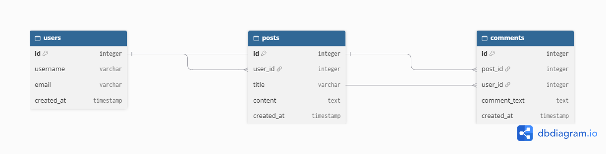

# Week 4: Blog Database Schema & SQL Queries

## Overview
This repository contains the relational database schema and SQL queries for a blogging platform featuring **Users**, **Posts**, and **Comments**.

## Database Schema Diagram

## Tables & Relationships
* **`users`**: Stores registered user accounts (`id`, `username`, `email`, `created_at`).
* **`posts`**: Stores blog articles linked to their author via `user_id` (One-to-Many relationship with `users`).
* **`comments`**: Stores user comments linked to both a specific post (`post_id`) and a commenter (`user_id`).

## Repository Contents
* **`blog-schema.png`**: Entity-Relationship Diagram (ERD) illustrating primary keys, foreign keys, and table relationships.
* **`blog_queries.sql`**: SQL script covering table creation (`CREATE TABLE`), sample data insertion (`INSERT`), relational joins (`SELECT ... JOIN`), and record updates/deletions (`UPDATE`, `DELETE`).
